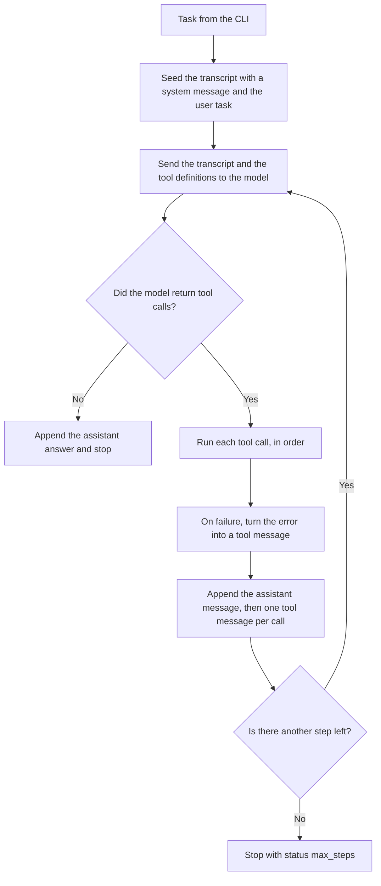

# agent-harness-small

Stage 1 of a from-scratch agent harness: **one model, a tool loop, and a trace**.

Later stages (a planner handing work to a worker, a parallel orchestrator, a trace viewer, evals) are not built here. The types they need already have a home, so they can be added without rewriting the loop.

There is no agent framework in this repo. The loop in `src/agent/loop.ts` is the whole harness.

## What an agent loop is

A chat model does not remember your last request, and it cannot run your code. Each HTTP call is a fresh function: transcript in, next message out.

An **agent loop** is the code around that function.

1. You send the transcript plus a list of tools (name, description, JSON schema).
2. The model either writes an answer, or it asks you to call one or more tools. It does not call them itself. It returns a name, an id, and a JSON argument string.
3. Your process runs the tool. You append two kinds of messages: the assistant message that requested the calls, then one tool message per result. The tool message carries the same id as the request.
4. You call the model again with the longer transcript.
5. You stop when the model stops asking for tools, or when you hit a step limit you chose.

The interesting part is step 3. A tool that throws is not a crash. The loop turns the error into a tool message (`Error: ...`) and lets the model decide what to do. The model is also free to ignore a tool and answer from memory. The trace is how you tell those cases apart.

One **step** in this project is one model call. Tools requested by that call always run, and then the budget is checked. `--max-steps 1` can therefore run a tool and stop before the model ever sees the result.



## Tour, in reading order

| File | What to look at |
| --- | --- |
| `src/types.ts` | The nouns: messages, a `ModelClient`, and trace events tagged `"v": 1`. |
| `src/tools/calculator.ts` | A whole tool in one file. `scratchpad.ts` and `fetch-url.ts` are the other two. |
| `src/tools/registry.ts` | Name plus JSON string in, text or a thrown error out. |
| `src/agent/model.ts` | The only file that knows about xAI. It maps our messages to the wire format. |
| `src/agent/loop.ts` | The loop. Short on purpose. |
| `src/trace/logger.ts` | The same events, once as stderr text and once as JSONL. |
| `src/cli.ts` | Argv, `.env`, and the wiring. Answer on stdout, trace on stderr. |
| `tests/loop.test.ts` | The loop driven by a fake model. No API key. |

`src/index.ts` re-exports that surface for later stages. A planner and a worker can be two `runAgent` calls with different prompts and tool lists. The returned `messages` array is the handoff. A viewer can read `traces/*.jsonl` without parsing the terminal. Evals can pass the same scripted `ModelClient` the unit tests use.

## Model and tools

The client is the official `openai` package pointed at `https://api.x.ai/v1`. The default model is `grok-4.7` (the flagship on the [models page](https://docs.x.ai/developers/models) as of October 2026). Override it with `XAI_MODEL` or `--model`.

Tool calls use the [Chat Completions](https://docs.x.ai/developers/model-capabilities/legacy/chat-completions) shape, which xAI still documents for this loop: a tool is `{ "type": "function", "function": { "name", "description", "parameters" } }`, and a result is `{ "role": "tool", "tool_call_id", "content" }`. The newer Responses API stores the conversation on the server. Stage 1 stays on Chat Completions so the transcript in this process is the whole conversation. That is the thing to understand first. `src/agent/model.ts` has a longer note on the difference.

`grok-4.7` is a reasoning model. A call can sit quietly before the tool call comes back, and the usage object may include reasoning tokens. The HTTP client does not retry (`maxRetries: 0`) and the default timeout is 120 seconds, so a failure shows up as a failure.

The three tools:

- `calculator` evaluates `+ - * /` and parentheses. It is a small parser, not `eval`.
- `scratchpad` reads or replaces a file in the scratch directory. Names are a single segment (`notes.txt`), so the model cannot walk out of that directory with `..`.
- `fetch_url` fetches `http` or `https` text, strips HTML, and truncates. It refuses localhost and private IPs, including after a redirect. It does not resolve DNS before connecting, so a public name that points at a private address still gets through. That limit is called out in the tool file.

## How to run

You need Node.js 22 or newer. Tests and the build do not need an API key.

```bash
npm install
npm test
npm run build
```

For a real run, copy the example env file and add a key from the [xAI console](https://console.x.ai/). `.env` is gitignored.

```bash
cp .env.example .env
npm run agent -- "What is (17 * 19) + 8? Use the calculator."
```

The `--` is required. It tells npm to hand the rest of the line to the script. The program writes the answer to stdout and the step trace to stderr, and it writes a JSONL file under `traces/`. `npm run` also prints the script name on stdout before the answer. `node dist/cli.js` and the Docker image do not.

```bash
npm run agent -- --max-steps 4 --model grok-4.7 "Summarize https://example.com"
```

Exit codes: `0` the model answered, `2` the step limit was hit, `1` bad usage, a missing key, or a model error.

`npm start -- "your task"` is the same CLI after `npm run build`, which is what the container runs.

### Docker

The image runs the same `dist/cli.js` entry point. It does not copy `.env`. Pass the key at runtime, and mount the output directories if you want the trace and the scratchpad on the host.

```bash
docker build -t agent-harness .
docker run --rm --env-file .env \
  -v "$PWD/traces:/app/traces" \
  -v "$PWD/scratch:/app/scratch" \
  agent-harness "What is (17 * 19) + 8? Use the calculator."
```

`docker run --rm agent-harness --help` prints the same help text as the local CLI. Without the volume mounts, `--rm` deletes the trace with the container.

## The trace file

Each run writes `traces/<timestamp>-<id>.jsonl`. One JSON object per line. Every object has `"v": 1`, a `type`, a `ts`, and a `runId`.

| `type` | What it records |
| --- | --- |
| `run_start` | model name, step budget, task |
| `model_request` | step, message count, roles, tool names. Not the full transcript. |
| `model_response` | finish reason, assistant text, tool calls, token usage, duration |
| `tool_call` | id, name, raw argument string |
| `tool_result` | id, name, `ok`, full output, duration |
| `run_end` | `finished`, `max_steps`, or `error` |

A request summary stays small on purpose. Tool arguments and tool outputs are stored in full, because that is what a viewer needs. The console prints a shortened line so a long page does not flood the terminal.

```json
{"v":1,"type":"tool_result","ts":"2026-10-23T21:00:00.000Z","runId":"example","step":1,"toolCallId":"call_1","name":"calculator","ok":true,"output":"331","durationMs":2}
```

## Things to try

Watch stderr, then open the JSONL file (`cat traces/*.jsonl`) after each one.

1. **A task that needs no tools.** `npm run agent -- "Reply with the single word hello."` The trace should be one model response and no `tool_call` line. The `model_request` event lists the roles `[system, user]`. You did not write the system message. It is `DEFAULT_SYSTEM_PROMPT` in `src/agent/loop.ts`, and the JSONL stores the role, not the text.

2. **Make it use the calculator.** `npm run agent -- "What is (17 * 19) + 8? Use the calculator tool."` Find the `tool_result`. The output should be `331`. If there is no `tool_call`, the model answered from memory. The loop did what it was told. Ask again and name the tool. The trace is how you know which of the two happened.

3. **A tool that fails.** `npm run agent -- "Fetch https://this-domain-does-not-exist.invalid/page and tell me what it says."` The process should stay up. Look for a `tool_result` with `"ok": false`, then another model response that talks about the error instead of inventing a page.

4. **A tiny step budget.** `npm run agent -- --max-steps 1 "Use the calculator to compute 2+2, then tell me the result."` Exit code `2`. Stdout says the run stopped. The trace shows the tool result and then `status=max_steps`. The model never gets a turn to read the `4`, because the limit is on model calls and the call that asked for the tool already spent it.

5. **A confusing task, then a bad expression.** `npm run agent -- "Read the secret number I stored in the scratchpad and tell me what it is."` Nothing is stored. The model should see `Error: scratchpad "notes.txt" does not exist yet...` and say so. If it invents a number, that invention is in the assistant text and there is no successful read above it. Then try `npm run agent -- "Use the calculator to evaluate sqrt(81). If that fails, write the word oops to the scratchpad and read it back."` `sqrt` is not arithmetic, so the parser throws, the loop hands the error back, and the model has to recover with the scratchpad. Check `scratch/notes.txt`.

## Exercise

Add a `word_count` tool yourself. Do not change the loop.

1. Create `src/tools/word-count.ts` that exports `createWordCountTool(): Tool`. Copy the shape of `src/tools/calculator.ts`. Take one string argument, `text`, and return the number of words (split on whitespace). Throw a clear error if `text` is missing. `execute` may throw. The loop already turns that into a tool message.
2. Register it in `createDefaultTools` in `src/tools/index.ts`. The description you write is what the model uses to decide when to call it.
3. Add `"word_count"` to the list in `tests/tools.test.ts`, and add a test that `the quick brown fox` is `4`.
4. `npm test`, then `npm run agent -- "How many words are in: the quick brown fox"`.

If the trace shows no `tool_call`, the model counted in its head. That is a successful run of the loop and a failed experiment. Tighten the task until the new tool appears in the JSONL.

## Layout

```
src/
  cli.ts                 argv, .env, wiring
  config.ts              environment variables
  types.ts               messages, model client, trace events
  index.ts               exports for later stages
  agent/
    loop.ts              the loop
    model.ts             xAI Chat Completions client
  tools/
    calculator.ts
    scratchpad.ts
    fetch-url.ts
    registry.ts          name lookup and JSON parsing
    index.ts             the default tool list
  trace/
    logger.ts            stderr and JSONL
tests/                   scripted model, no API key
```
